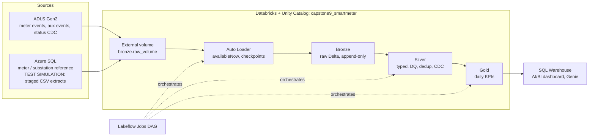
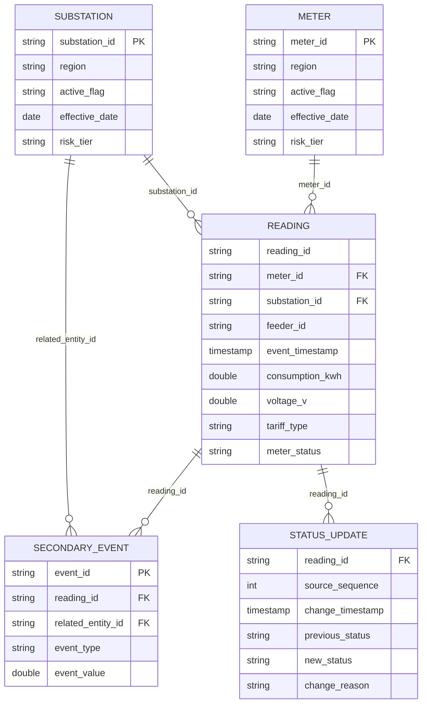

# Capstone 09 Smart Meter - Architecture (Day 1)

## Scope and source grain

* Business goal: reliable daily energy KPIs per meter / substation with interval completeness and late-read reconciliation.
* Source grain (Bronze): **one event row per `reading_id` per source arrival**. Duplicates, nulls, extremes and later status revisions are kept in Bronze and resolved in Silver.
* BRS: not available in the workspace; this document captures the requirements taken from the Implementation Playbook. Link the BRS here when provided.

## HLD

## LLD (Day 1 - Bronze)

| Component | Implementation |
| --- | --- |
| Catalog / schema | `capstone9_smartmeter.bronze` |
| Source volume (read-only) | `bronze.raw_volume` (EXTERNAL, `abfss://capstone09@smartmeter09.dfs.core.windows.net/smartmeterdata`) |
| Ingestion | Auto Loader `cloudFiles` CSV, `header=true`, `inferColumnTypes=false` (raw STRING), `trigger(availableNow=True)`, append |
| Schema / checkpoint locations | `bronze.pipeline_meta/_schemas/<source>`, `bronze.pipeline_meta/_checkpoints/<source>` |
| Lineage columns | `_input_file_name` (`_metadata.file_path`), `_ingestion_timestamp` (`current_timestamp()`), `_rescued_data` |
| Schema drift | New column `source_schema_version` (batches 10-12) added automatically; `mergeSchema=true` on write |
| Event tables | `primary_events_raw`, `secondary_events_raw`, `status_updates_raw` (notebook `day1/01_bronze_ingestion_autoloader`) |
| Reference tables | `bronze_meter_id`, `bronze_substation_id` (Ingestion owner, Auto Loader from `azure_sql_extracts/`) |

## ERD (logical)

`reading_id` is not unique in Bronze (40 exact duplicates); it becomes the business key of the Silver reading after deduplication.

